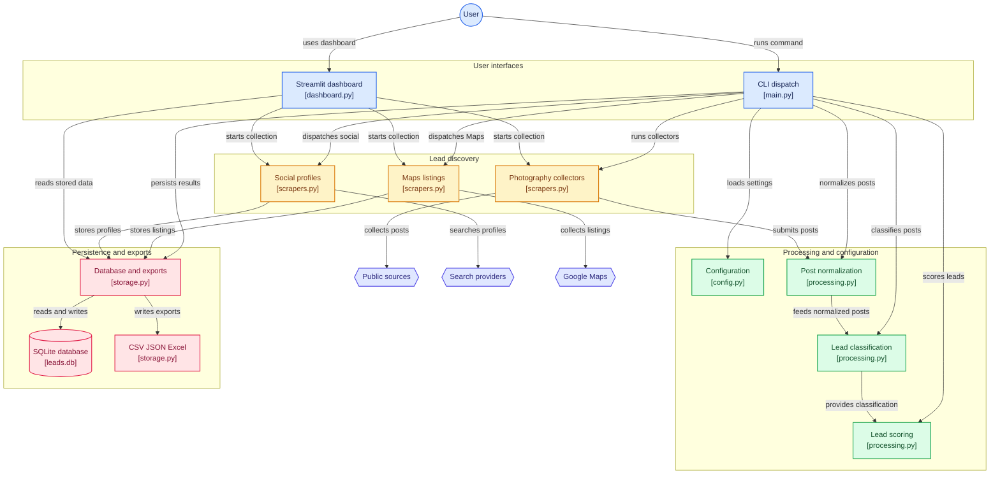

# LEAD_SCRAPER

<p align="center">
  <strong>A unified toolkit for discovering and organizing public business, professional-profile, and photography-service leads.</strong>
</p>

<p align="center">
  
  
  
  
</p>

LEAD_SCRAPER brings three public-data lead-discovery workflows into one Python project:

1. **Google Maps Lead Scraper** — discovers business listings using a keyword and location.
2. **LinkedIn and Instagram Profile Scraper** — discovers public professional and creator profiles.
3. **Photography Leads Scraper** — identifies public posts that indicate a possible need for photography services.

The project includes a Streamlit dashboard, a shared SQLite database, and CSV, JSON, and Excel exports.

> [!IMPORTANT]
> The project does not bypass authentication, CAPTCHAs, `robots.txt` restrictions, rate limits, or other access controls. Search-result and public-page data is unverified and should be validated before use. Collection volumes are targets, not guarantees.

---

## Contents

- [Project overview](#project-overview)
- [Sample collection results](#sample-collection-results)
- [Architecture](#architecture)
- [Technology stack](#technology-stack)
- [Requirements](#requirements)
- [Installation](#installation)
- [Configuration](#configuration)
- [Running the dashboard](#running-the-dashboard)
- [Using the tools](#using-the-tools)
  - [Tool 1: Google Maps](#tool-1-google-maps-lead-scraper)
  - [Tool 2: LinkedIn and Instagram](#tool-2-linkedin-and-instagram-profile-scraper)
  - [Tool 3: Photography leads](#tool-3-photography-leads-scraper)
- [Command-line reference](#command-line-reference)
- [Output files and data storage](#output-files-and-data-storage)
- [Data quality and responsible collection](#data-quality-and-responsible-collection)
- [Verification and testing](#verification-and-testing)
- [Assignment deliverables](#assignment-deliverables)

---

## Project overview

| Tool                        | Purpose                                                   | Main information collected                                                                                       |
| --------------------------- | --------------------------------------------------------- | ---------------------------------------------------------------------------------------------------------------- |
| **Google Maps**       | Find businesses matching a keyword and location           | Business name, category, address, phone, website, rating, review count, and Maps URL                             |
| **LinkedIn**          | Discover public professional profiles                     | Name, headline, current company, location, About excerpt, and profile URL                                        |
| **Instagram**         | Discover public creator and business profiles             | Username, full name, bio, follower/following/post counts, public email/phone values, and profile URL             |
| **Photography leads** | Identify public expressions of photography-service intent | Author/handle, post URL, post content, location when explicitly stated, intent evidence, and lead classification |

The social-profile collectors use public search-result snippets rather than logged-in profile pages. Missing information remains blank instead of being inferred or fabricated. Records include `verification`, `data_quality`, and `field_status` labels to make extraction limitations visible.

## Sample collection results

The sample exports in `output/` were generated on **17 November 2026**. Counts may vary between runs because public search results and archives change.

| Tool        | Sample result                                       | Collection notes                                                                                                                                           |
| ----------- | --------------------------------------------------- | ---------------------------------------------------------------------------------------------------------------------------------------------------------- |
| Google Maps | **105 unique Bengaluru photography listings** | 120 candidates were requested; 105 valid unique rows remained after extraction failures and URL deduplication.                                             |
| LinkedIn    | **240 unique profiles**                       | 236 names/headlines, 128 current companies, 84 locations, and 141 public About excerpts. Snippet-only records remain labeled unverified.                   |
| Instagram   | **125 unique profiles**                       | 121 full names, 103 bios, 122 follower/following/post-count sets, and 30 public email/phone values.                                                        |
| Photography | **111 qualified leads**                       | All Hot; 111 unique post URLs; no duplicate author/title crossposts; 27 titles name a location; drawn from 2,009 stored public posts.                      |

These are recorded sample results, not promises about future collection runs.

---

## Architecture

### Project structure

```text
LEAD_SCRAPER/
├── .env
├── .env.example
├── .gitignore
├── requirements.txt
├── README.md
├── main.py
├── lead_scraper/
│   ├── __init__.py
│   ├── config.py
│   ├── dashboard.py        # Streamlit UI
│   ├── scrapers.py
│   ├── processing.py
│   └── storage.py
├── data/
│   └── leads.db
└── output/
    ├── maps/
    ├── social/
    └── photography/
```

### High-level workflow



### Module responsibilities

| Module                         | Responsibility                                                                        |
| ------------------------------ | ------------------------------------------------------------------------------------- |
| `main.py`                    | CLI entry point and command dispatch for Maps, social profiles, and photography leads |
| `lead_scraper/config.py`     | Loads configuration and environment variables                                         |
| `lead_scraper/scrapers.py`   | Contains the collection implementations                                               |
| `lead_scraper/processing.py` | Handles processing, normalization, deduplication, and photography-intent scoring      |
| `lead_scraper/storage.py`    | Persists data in SQLite and writes JSON, CSV, and Excel exports                       |
| `lead_scraper/dashboard.py`  | Provides the Streamlit dashboard                                                      |

`lead_scraper/config.py` loads the single root `.env` file using an absolute path, so commands work regardless of the current working directory. Existing shell environment variables take precedence. Secrets are not stored in Python source files.

---

## Technology stack

| Area                             | Technology                                                      |
| -------------------------------- | --------------------------------------------------------------- |
| Language                         | Python 3.10+                                                    |
| Dynamic-page automation          | Playwright                                                      |
| Static-page requests and parsing | Requests and Beautiful Soup                                     |
| Search and collection            | Configured public search providers and public-source collectors |
| Data processing                  | Pandas and regular expressions                                  |
| Database                         | SQLite                                                          |
| Exports                          | CSV, JSON, and Excel                                            |
| Dashboard                        | Streamlit                                                       |

---

## Requirements

- Windows with PowerShell, or another environment capable of running Python.
- Python **3.10 or later**.
- Git for cloning the repository.
- Internet access for public search and collection sources.
- Approved API credentials in `.env` where required.
- Playwright Chromium for browser-based collection.

## Installation

### 1. Clone the repository and open the project directory

```powershell
git clone https://github.com/NYN-05/LEAD_SCRAPER.git
cd LEAD_SCRAPER
```

### 2. Create and activate a virtual environment

```powershell
py -m venv .venv
.\.venv\Scripts\Activate.ps1
```

If PowerShell prevents activation because of the execution policy, use an appropriate user-level policy permitted by your machine's security settings, or run the virtual-environment Python executable directly.

### 3. Install dependencies

```powershell
py -m pip install -U pip
py -m pip install -r requirements.txt
```

### 4. Install the Playwright browser

```powershell
py -m playwright install chromium
```

---

## Configuration

1. Copy `.env.example` to `.env`.
2. Add approved API credentials and optional configuration values where needed.
3. Keep `.env` local; it is excluded by `.gitignore`.

The application reads the root `.env` file through an absolute path. Environment variables already defined in the shell take precedence over values in `.env`.

**Do not commit API keys, tokens, passwords, or other secrets to the repository.**

---

## Running the dashboard

Install dependencies if they have not already been installed, then launch Streamlit:

```powershell
py -m pip install -r requirements.txt
py -m streamlit run main.py
```

The dashboard provides the following sections:

- **Overview**
- **Google Maps**
- **LinkedIn / Instagram**
- **Photography Leads**

Collection jobs run in background workers. Tables and metrics read from the shared SQLite database. Use the sidebar refresh control to reload stored results.

---

## Using the tools

### Tool 1: Google Maps Lead Scraper

The Maps collector searches for businesses using a keyword and location, extracts public listing information, and removes duplicate listings.

**Example**

```powershell
py main.py maps --keyword "photography studio" --location Bengaluru --max-results 120
```

**Available output fields**

- Business name
- Business category
- Address
- Phone number, when publicly available
- Website, when publicly available
- Rating and review count, when available
- Canonical Google Maps URL

**Collection behavior**

- Uses Playwright to interact with Maps result pages.
- Scrolls result feeds to discover additional listings.
- Extracts public listing fields.
- Deduplicates canonical Maps URLs.
- Retries transient navigation failures.
- Retains per-listing diagnostics.
- Resolves Google `/url?q=...` redirects to the actual business website and removes tracking parameters, preventing relative Google redirect links from appearing in exports.
- Persists valid listings in the `map_leads` SQLite table.
- Exports results to CSV, JSON, and Excel.

The sample export used the command above: 120 candidates produced 105 valid unique listings. Additional candidates provide room for extraction failures and duplicate Maps URLs. A run requesting 100 candidates may therefore finish with fewer than 100 valid rows. The tool reports the shortfall rather than padding the export.

### Tool 2: LinkedIn and Instagram Profile Scraper

Use the `social` subcommand to discover and collect public LinkedIn and Instagram profile information. Each platform is exported independently to CSV, JSON, and Excel, and stored in the `social_profiles` SQLite table.

**Examples**

```powershell
# Run offline parser tests
py main.py social --self-test

# Search public profiles by location
py main.py social --location Bengaluru --max-results 20 --no-profile-fetch

# Collect from supplied LinkedIn profile URLs
py main.py social --linkedin-urls "https://www.linkedin.com/in/example/"

# Discover Instagram profiles by keyword and location
py main.py social --instagram-keywords photographer --location Bengaluru
```

#### Search providers and discovery behavior

Optional Brave Search and Google Programmable Search credentials are read from the root `.env` file. DDGS remains the fallback provider.

Discovery uses Yahoo's Bing-indexed results by default and falls back to DDGS `auto` if Yahoo applies rate limits. The default backend sequence is `yahoo,auto`.

Yahoo returned LinkedIn and Instagram profile results more reliably than DuckDuckGo's meta-search `auto` selection in this environment. The installed `ddgs` 9.x package does not expose `bing` as a backend key; `yahoo` is the Bing-indexed engine, and `--backend bing` is accepted as a compatibility alias for `yahoo`.

#### Search volume and collection targets

`--max-results` is a **target**, not a hard cap on search effort. The scraper iterates through query variants and result pages until one of the following conditions is met:

- The requested target is reached.
- The search budget (`--max-search-requests`) is exhausted.
- Three consecutive pages return no new results.

**Example: broader discovery run**

```powershell
py main.py social `
  --location Bangalore `
  --max-results 100 `
  --pages 15 `
  --max-search-requests 80 `
  --backend yahoo,auto `
  --region in-en
```

Query generation accepts comma-separated keywords, for example:

```powershell
py main.py social --linkedin-keywords "photographer, wedding photographer"
```

The query generator expands common location aliases such as Bangalore and Bengaluru. It tries unquoted queries before quoted precision variants because quoted Instagram queries frequently return zero results.

LinkedIn country subdomains such as `in.linkedin.com` and `uk.linkedin.com` are normalized to `https://www.linkedin.com/in/<slug>/` so that the same profile is not counted more than once.

#### Public profile fetching and validation

Public profile fetching is attempted only when permitted by `robots.txt`.

Each record includes a `field_status` JSON object whose values indicate whether a field was `extracted` or `unavailable`.

The `data_quality` field distinguishes URL-only records from records containing identity or contextual information. URL-only records are not counted as valid profiles in the printed summary.

Profile URLs are normalized and deduplicated case-insensitively. LinkedIn About information and Instagram contact fields remain blank unless the public page or an exact-account public search snippet exposes them.

#### Platform limitations

The platforms may return fewer than 100 enriched records. LinkedIn and Instagram can require login, deny automated requests, or restrict search-engine indexing.

The scraper stops when it encounters:

- `robots.txt` restrictions or robots failures
- HTTP 403 responses
- HTTP 429 responses
- CAPTCHAs
- Redirects that prevent permitted access

It does not bypass these controls or rotate proxies. The summary reports provider errors, valid-record counts, and per-field completeness so that access limitations remain explicit.

### Tool 3: Photography Leads Scraper

The photography collector identifies public posts that indicate a possible need for photography services. It supports multiple public sources and classifies qualified posts using explainable intent rules.

**Examples**

```powershell
# Run with the default sources
py main.py

# Search Reddit with a larger collection ceiling and a delay
py main.py --sources reddit --max-posts 9000 --delay 1.5

# Restrict Reddit collection to selected subreddits
py main.py --sources reddit --subreddits "weddingphotography,photography"

# Collect from an RSS feed
py main.py --sources rss --rss-feeds "https://example.com/feed.xml"

# Search Bluesky for a phrase
py main.py --sources bluesky --keywords "need a photographer"

# Choose an output directory and disable Excel export
py main.py --output output/photography --no-excel
```

#### Supported public sources

Collectors for the following sources are consolidated in `lead_scraper/scrapers.py`:

- Bluesky
- Mastodon
- Reddit
- Discourse
- RSS / Atom feeds

The default sources are `mastodon,reddit`.

Reddit uses OAuth when `REDDIT_ID` and `REDDIT_SECRET` are configured. Otherwise, it falls back to the public PullPush Reddit archive, which does not require login.

The Reddit archive returns at most 100 recent submissions per query, so `--max-posts` is a ceiling rather than a guarantee. A 100-lead sample usually requires several thousand raw archive posts. The example command uses `--max-posts 9000` because the archive is large. Use `--delay 1.5` or a higher value to stay within the public host's rate limits.

Reddit requests back off after HTTP 429 responses and transient connection failures rather than rotating identities or bypassing limits. PullPush returns public submissions only; the collector skips over-18 posts and removed or deleted bodies.

#### Lead classification

Classification is intent-based and explainable. When a post has a title, the classifier evaluates the title rather than the body because long Reddit bodies often mention photography only in passing, such as in stories, novels, or gear questions.

| Classification | Meaning                                                                             | Examples of intent                                                                                               |
| -------------- | ----------------------------------------------------------------------------------- | ---------------------------------------------------------------------------------------------------------------- |
| **Hot**  | The author explicitly expresses a buying or hiring intent.                          | Asks to hire a photographer, requests a recommendation, or asks about pricing or quotes.                         |
| **Warm** | The author describes an upcoming or planned photography requirement.                | Mentions a future event or a planned need for photography services.                                              |
| **Cold** | The content indicates general interest rather than a qualified service requirement. | General photography interest, hobby discussion, gear questions, provider promotion, or third-party testimonials. |

Cold posts are not saved as qualified leads.

#### Lead fields and location handling

Each qualified export retains:

- Original post URL
- Post title
- Post text
- Author handle
- Collection timestamp
- `intent_evidence` matched by the classifier

The `location` field is populated only when the title explicitly names a place. It remains blank rather than being inferred from a subreddit or unrelated body text.

#### Deduplication and access handling

Posts are deduplicated using:

- Source identity
- Canonical URL
- Normalized author/content fingerprint
- Author/title crosspost matching

If a source returns HTTP 403 or 429, the result is recorded as an access limitation. The collector does not retry through proxies or alternate evasion routes. Other configured public sources continue independently.

Processing and scoring rules are maintained in `lead_scraper/processing.py`. SQLite persistence and JSON, CSV, and Excel exports are handled by `lead_scraper/storage.py`.

---

## Command-line reference

The following tables document the supported command-line arguments. Explicit values override the defaults.

### Task 1: Google Maps

| Argument          | Purpose                                                | Default                  |
| ----------------- | ------------------------------------------------------ | ------------------------ |
| `--keyword`     | Business or search keyword                             | `"photography studio"` |
| `--location`    | Search location                                        | `"Bengaluru"`          |
| `--max-results` | Maximum Maps listings to collect                       | `100`                  |
| `--headed`      | Show the browser window instead of using headless mode | Disabled                 |

**Examples**

```powershell
py main.py maps
py main.py maps --keyword "wedding photographer" --location "Mumbai" --max-results 50
```

### Task 2: LinkedIn and Instagram

| Argument                  | Purpose                                           | Default              |
| ------------------------- | ------------------------------------------------- | -------------------- |
| `--input-json`          | Load search/profile inputs from a JSON file       | None                 |
| `--linkedin-urls`       | Comma-separated LinkedIn profile URLs             | `""`               |
| `--instagram-urls`      | Comma-separated Instagram profile URLs            | `""`               |
| `--linkedin-keywords`   | LinkedIn discovery keywords                       | `"Data Scientist"` |
| `--instagram-keywords`  | Instagram discovery keywords                      | `"photographer"`   |
| `--hashtag`             | Hashtag filter                                    | `""`               |
| `--location`            | Search location for both platforms                | `"Bengaluru"`      |
| `--max-results`         | Maximum profiles per platform                     | `100`              |
| `--min-delay`           | Minimum delay between search requests, in seconds | `2.0`              |
| `--max-delay`           | Maximum delay between search requests, in seconds | `4.0`              |
| `--retries`             | Number of transient search retries                | `2`                |
| `--backend`             | Comma-separated DDGS backends in priority order   | `"yahoo,auto"`     |
| `--pages`               | Result pages requested per query                  | `15`               |
| `--max-search-requests` | Search-request budget per platform                | `80`               |
| `--region`              | DDGS region code                                  | `"in-en"`          |
| `--output-dir`          | Profile output directory                          | `"output/social"`  |
| `--no-targeted-lookup`  | Disable individual lookup for supplied URLs       | Disabled             |
| `--no-profile-fetch`    | Use search-result snippets only                   | Disabled             |
| `--request-timeout`     | Public profile request timeout, in seconds        | `15.0`             |
| `--self-test`           | Run offline parser tests and exit                 | Disabled             |
| `--check-search`        | Run a search-provider connectivity check and exit | Disabled             |
| `--log-level`           | Logging level                                     | `"INFO"`           |

**Examples**

```powershell
py main.py social
py main.py social --max-results 50 --location Mumbai
```

### Task 3: Photography leads

| Argument                 | Purpose                              | Default                    |
| ------------------------ | ------------------------------------ | -------------------------- |
| `--location`           | Target location filter               | None / root `.env` value |
| `--keywords`           | One or more search phrases           | Root-configured keywords   |
| `--sources`            | Comma-separated public sources       | `mastodon,reddit`        |
| `--mastodon-instances` | Comma-separated Mastodon servers     | `mastodon.social`        |
| `--subreddits`         | Comma-separated Reddit subreddits    | All / default              |
| `--discourse-sites`    | Comma-separated Discourse URLs       | None                       |
| `--rss-feeds`          | Comma-separated RSS / Atom feed URLs | None                       |
| `--max-posts`          | Maximum posts per source             | `100`                    |
| `--min-score`          | Minimum lead score                   | `0`                      |
| `--delay`              | Request delay, in seconds            | `1.0`                    |
| `--db`                 | SQLite database path                 | `data/leads.db`          |
| `--output`             | Output directory                     | `output/photography`     |
| `--excel`              | Enable Excel export                  | Enabled                    |
| `--no-excel`           | Disable Excel export                 | Disabled                   |

**Examples**

```powershell
py main.py
py main.py --max-posts 50 --sources mastodon,rss
```

> [!NOTE]
> The default value of `100` is a collection target. Platform restrictions, unavailable sources, duplicate removal, and validation can result in fewer valid records. Explicit limit arguments override the defaults.

---

## Output files and data storage

### Canonical exports

| Tool                       | Canonical output location              | Formats          |
| -------------------------- | -------------------------------------- | ---------------- |
| Google Maps                | `output/maps/google_maps_leads.*`    | CSV, JSON, Excel |
| LinkedIn                   | `output/social/linkedin_profiles.*`  | CSV, JSON, Excel |
| Instagram                  | `output/social/instagram_profiles.*` | CSV, JSON, Excel |
| Photography                | `output/photography/leads.*`         | CSV, JSON, Excel |
| Photography raw collection | `output/photography/raw_posts.json`  | JSON             |

### Compatibility copies

The project also maintains root-level copies for compatibility with existing scripts and assignment paths:

- `output/leads.json`, `output/leads.csv`, and `output/leads.xlsx` mirror the photography exports.
- `output/linkedin_profiles.*` and `output/instagram_profiles.*` mirror the platform-separated social exports.
- `output/google_maps_leads.*` mirrors the Maps exports.

The dashboard keeps Maps, social profiles, and photography exports in separate `output\maps`, `output\social`, and `output\photography` directories so one tool does not overwrite another tool's files.

### Database

`data/leads.db` stores the SQLite data. The photography workflow retains the SQLite schema and normalizes stored posts on each run, allowing classifier changes to be applied to the complete stored sample.

### Export notes

- `output/photography/leads.json`, `leads.csv`, and `leads.xlsx` are the canonical qualified photography-lead exports.
- Use `--no-excel` only when the spreadsheet export is not required.
- Maps listings are stored in the `map_leads` SQLite table.
- Social profile records are stored in the `social_profiles` SQLite table.

No external API scraping is claimed to succeed unless it is run and returns results in the current environment.

---

## Data quality and responsible collection

The project is designed to work with publicly accessible information and to make collection limitations visible.

- Collect public data only.
- Respect `robots.txt`, platform terms, rate limits, and access restrictions.
- Prefer official APIs where available and approved.
- Do not bypass authentication, CAPTCHAs, HTTP 403/429 restrictions, or other access controls.
- Do not use proxy rotation or alternate routes to evade blocks.
- Do not store private data.
- Leave unavailable fields blank; do not invent or infer missing values.
- Preserve source URLs and intent evidence where applicable.
- Deduplicate records before exporting.
- Treat search-result and public-page data as unverified until independently validated.

The `verification`, `data_quality`, and `field_status` labels help distinguish extracted values from unavailable or insufficiently verified information. Collection summaries report valid-record counts, provider errors, and field completeness rather than hiding shortfalls.

---

## Verification and testing

### Run the test suite

```powershell
py -m unittest discover -s tests -v
```

### Check exported row counts and URL uniqueness

Run the following PowerShell command from the project root:

```powershell
@'
import csv

checks = (
    ("output/maps/google_maps_leads.csv", "maps_url"),
    ("output/social/linkedin_profiles.csv", "profile_url"),
    ("output/social/instagram_profiles.csv", "profile_url"),
    ("output/photography/leads.csv", "post_url"),
)

for path, key in checks:
    with open(path, encoding="utf-8-sig", newline="") as file:
        rows = list(csv.DictReader(file))
    unique_values = {row[key] for row in rows}
    print(path, "rows:", len(rows), "unique:", len(unique_values))
'@ | py -
```

This check reports the number of rows and the number of unique source URLs for each canonical CSV export.

---

## Assignment deliverables

| Deliverable                                       | Implementation or location                                                       |
| ------------------------------------------------- | -------------------------------------------------------------------------------- |
| **Task 1: Google Maps leads**               | `py main.py maps` — `MapsScraper` in `lead_scraper/scrapers.py`           |
| **Task 2: LinkedIn and Instagram profiles** | `py main.py social` — `scrape_platform` in `lead_scraper/scrapers.py`     |
| **Task 3: Photography buying-intent leads** | `py main.py` — `run_photography` in `main.py`                             |
| **Dashboard**                               | `py -m streamlit run main.py`                                                  |
| **Maps sample exports**                     | `output/maps/google_maps_leads.csv`, `.json`, `.xlsx`                      |
| **Social sample exports**                   | `output/social/linkedin_profiles.*` and `output/social/instagram_profiles.*` |
| **Photography sample exports**              | `output/photography/leads.csv`, `.json`, `.xlsx`                           |
| **Shared storage**                          | `data/leads.db`                                                                |

The `100` values are collection targets. Restrictions, duplicate removal, unavailable sources, and validation may result in fewer valid records. The printed summaries and `data_quality` / `field_status` columns report any shortfall instead of concealing it.

---

<p align="center">
  <sub>LEAD_SCRAPER · Public-data lead discovery and organization</sub>
</p>
